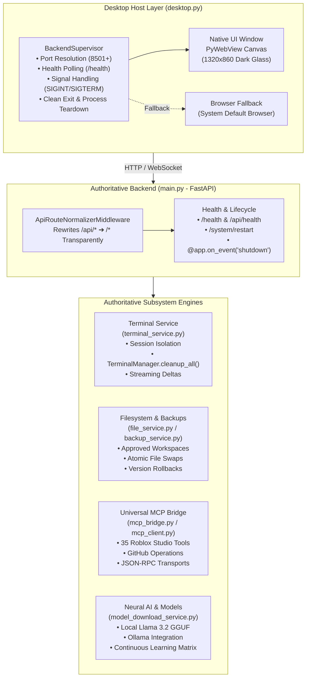

# Stroke V1 — Architecture Consolidation Specification

**Authoritative Backend:** Python FastAPI (`main.py`)  
**Authoritative Desktop Host:** Python Native Process Supervisor & Desktop Runner (`desktop.py` / PyWebView)  
**Authoritative Terminal Service:** Python Background Terminal Engine (`terminal_service.py`)  
**Authoritative Production Frontend:** Unified Cyberpunk SPA (served by FastAPI at `/`, backed by `index.html`)  
**Canonical Client API Gateway:** Bidirectional `/api/*` and `/*` Normalizer Middleware  
**Status:** Approved Canonical Architecture Specification  

---

## 1. System Overview & Component Diagram

Stroke V1 consolidates previously competing runtimes into a single, cohesive, production-grade desktop application.



---

## 2. Core Architectural Decisions

### 2.1 Backend Authority: Python FastAPI (`main.py`)
- **Decision:** Python FastAPI remains the sole, authoritative system and AI backend.
- **Rationale:** Stroke's core competencies—local GGUF neural inference (`llama-cpp-python`), MCP subprocess communication, PTY terminal execution, AST parsing, and atomic filesystem backups—are native to Python. Retaining FastAPI avoids cross-language serialization overhead and provides an async, high-performance foundation.

### 2.2 Production Frontend: Unified Cyberpunk SPA (`index.html`)
- **Decision:** The single-page Cyberpunk interface served directly by FastAPI at `/` (`index.html`) is selected as the sole canonical production UI.
- **Rationale:** 
  1. **Full Feature Parity:** The unified UI implements 100% of required user-facing capabilities:
     - 35 native Roblox Studio MCP tools with live instance tree inspection.
     - Real-time ANSI terminal output delta streaming.
     - Approved workspace folder selection and directory permission gating.
     - Automated backup snapshots, diff inspections, and one-click rollback.
     - Offline GGUF neural weight bootstrapper with live progress and SHA-256 validation.
     - Speech-to-text audio synthesis and multimodal attachments.
  2. **TanStack React Client Role:** The TanStack Start client under `src/` is retained for developer reference and headless routing tests (`npm test` / Vitest). All mock and simulated code (such as simulated GitHub pushes and random timer boots) has been cleaned and re-routed to real `/api/*` endpoints. However, it does not replace `index.html` as the primary production interface until all 35 MCP tools and live terminal visualizers are ported.

### 2.3 Shipping Desktop Host: PyWebView (`desktop.py`)
- **Decision:** PyWebView via `desktop.py` is the single authoritative desktop shell. Tauri (`src-tauri/`) is retired.
- **Rationale:**
  1. **Runtime Consolidation:** FastAPI requires Python. Packaging Python + Tauri requires shipping two independent runtime environments (Rust binary + bundled Python sidecar), leading to process lifecycle desynchronization, port collision races, and doubled distribution size.
  2. **Zero-Sidecar Simplicity:** `desktop.py` runs inside the same Python virtualenv or PyInstaller bundle as FastAPI, allowing in-process supervision, direct thread management, and clean OS signal trapping (`SIGINT`, `SIGTERM`).
  3. **Multi-Platform Resilience:** PyWebView uses native platform web engines (WebKit on macOS, WebView2 on Windows, WebKitGTK on Linux) and automatically falls back to the system default browser if graphical window libraries are absent.

### 2.4 Authoritative Terminal Service: Python `TerminalManager` (`terminal_service.py`)
- **Decision:** `terminal_service.py` is the sole authoritative terminal execution engine. The duplicate Rust terminal in `src-tauri/src/terminal.rs` is retired.
- **Rationale:** 
  - `terminal_service.py` is deeply integrated with Stroke's security boundary: workspace isolation (`DEFAULT_WORKSPACE`), command allowlists (`SAFE_ROUTINE_COMMANDS`), the Absolute No-Delete Policy for AI commands, ring-buffered memory limits (256 KB), and secret redaction patterns.
  - Rust's `terminal.rs` had broken approval loops, no integration with `coding_loop.py`, and was susceptible to orphaned background processes.
  - `terminal_service.py` now implements `TerminalManager.cleanup_all()`, guaranteeing that when the desktop host exits or restarts, all active child processes are terminated.

### 2.5 Authoritative MCP Subsystem: `mcp_bridge.py` + `mcp_client.py`
- **Decision:** Consolidate external tool calling into `mcp_bridge.py` as the tool registry and `mcp_client.py` as the JSON-RPC transport.
- **Rationale:** `mcp_bridge.py` contains the complete dispatch table for all 35 Roblox Studio tools and GitHub REST APIs. Duplicate configurations in `data/mcp_config.json` have been reconciled so that tool discovery dynamically maps to running processes.

---

## 3. Communication Contract & API Normalization

### 3.1 Transparent Route Normalizer
To prevent any mismatch between frontend clients requesting `/api/<route>` and backend routes defined at `/<route>`, `main.py` incorporates the `ApiRouteNormalizerMiddleware`:

```python
class ApiRouteNormalizerMiddleware:
    """
    Normalizes /api/* requests so frontend and API clients can use either
    /api/<endpoint> or /<endpoint> interchangeably without route mismatch.
    """
    def __init__(self, app):
        self.app = app

    async def __call__(self, scope, receive, send):
        if scope["type"] == "http":
            path = scope.get("path", "")
            if path.startswith("/api/") and path != "/api/":
                scope["path"] = path[4:]
        await self.app(scope, receive, send)
```

### 3.2 Canonical API Dictionary

| Subsystem | Canonical Path | Normalized `/api` Path | HTTP Method | Request / Response Contract |
|---|---|---|---|---|
| **System** | `/health` | `/api/health` | `GET` | **Res:** `{"status": "healthy", "service": "stroke-backend", "uptime_seconds": float, "pid": int, "active_terminals": int}` |
| **System** | `/system/restart` | `/api/system/restart` | `POST` | **Req:** `{}` (Loopback only) <br/> **Res:** `{"status": "restarting", "pid": int}` |
| **AI Engine** | `/ai/chat` | `/api/ai/chat` | `POST` | **Req:** `{"messages": [{"role": "user", "content": "..."}], "prompt": "...", "reasoning_level": "medium"}` <br/> **Res:** `{"status": "success", "message": "...", "tool_invoked": bool}` |
| **AI Engine** | `/ai/status` | `/api/ai/status` | `GET` | **Res:** `{"engine": "...", "local_model": {...}, "ollama": {"online": bool}}` |
| **Terminal** | `/terminal/create` | `/api/terminal/create` | `POST` | **Req:** `{"workspace_path": "..."}` <br/> **Res:** `{"session_id": "term-..."}` |
| **Terminal** | `/terminal/run` | `/api/terminal/run` | `POST` | **Req:** `{"session_id": "...", "command": "...", "args": [...]}` <br/> **Res:** `{"exit_code": int, "stdout": "...", "stderr": "..."}` |
| **Terminal** | `/terminal/output/delta` | `/api/terminal/output/delta` | `GET` | **Query:** `session_id=...&since_seq=int` <br/> **Res:** `{"lines": [...], "latest_seq": int}` |
| **Terminal** | `/terminal/{id}/stop` | `/api/terminal/{id}/stop` | `POST` | **Res:** `{"status": "stopped", "session_id": "..."}` |
| **Filesystem** | `/fs/read` | `/api/fs/read` | `POST` | **Req:** `{"file_path": "..."}` <br/> **Res:** `{"content": "...", "sha256": "..."}` |
| **Filesystem** | `/fs/edit` | `/api/fs/edit` | `POST` | **Req:** `{"file_path": "...", "content": "...", "description": "..."}` <br/> **Res:** `{"status": "success", "backup": {...}}` |
| **Workspaces** | `/workspace/list-approved`| `/api/workspace/list-approved`| `GET` | **Res:** `{"workspaces": ["/path/to/project"]}` |
| **Workspaces** | `/workspace/approve` | `/api/workspace/approve` | `POST` | **Req:** `{"path": "/path/to/project"}` <br/> **Res:** `{"status": "approved"}` |
| **Backups** | `/backups/history` | `/api/backups/history` | `GET` | **Query:** `file_path=...` <br/> **Res:** `{"backups": [...]}` |
| **Backups** | `/backups/{id}/restore`| `/api/backups/{id}/restore` | `POST` | **Res:** `{"status": "success", "restored_backup_id": "..."}` |
| **MCP** | `/mcp/tools` | `/api/mcp/tools` | `GET` | **Res:** `{"status": "success", "roblox_studio_tools": [...]}` |
| **MCP** | `/mcp/execute` | `/api/mcp/execute` | `POST` | **Req:** `{"tool_name": "...", "arguments": {...}}` <br/> **Res:** `{"status": "success", "result": {...}}` |
| **GitHub** | `/github/status` | `/api/github/status` | `GET` | **Res:** `{"configured": bool, "vault_file_exists": bool}` |
| **GitHub** | `/github/token` | `/api/github/token` | `POST` | **Req:** `{"token": "ghp_..."}` <br/> **Res:** `{"status": "saved"}` |

---

## 4. Process Supervision & Lifecycle Management

### 4.1 Process Supervisor Architecture (`BackendSupervisor`)
The desktop entry point (`desktop.py`) implements a managed worker loop:

```text
[desktop.py:main()]
      │
      ├── 1. AI Weights Check (check_and_bootstrap_ai)
      │      Validates existence of local GGUF weights; triggers background download if missing.
      │
      ├── 2. Safe Port Resolution (find_available_port starting at 8501)
      │      Tests loopback bind availability using SO_REUSEADDR and active /health probing.
      │
      ├── 3. BackendSupervisor.start()
      │      Launches uvicorn.Server in a managed daemon thread.
      │      Active health polling against http://127.0.0.1:PORT/health (timeout: 15s).
      │
      ├── 4. Launch Desktop Window
      │      Opens 1320x860 PyWebView window. If UI libraries missing, opens system browser.
      │
      └── 5. Clean Application Exit
             On window close / SIGINT / SIGTERM:
             • Signal uvicorn server should_exit = True
             • Join supervisor thread
             • Invoke TerminalManager.cleanup_all() to reclaim child processes
             • Terminate cleanly (exit code 0)
```

### 4.2 Port Conflict & Race Condition Strategy
1. **Initial Port Selection:** The default preferred port is `8501` (configurable via `STROKE_PORT` or `PORT`).
2. **Conflict Detection:** `find_available_port()` binds to loopback (`127.0.0.1`) with `SO_REUSEADDR`.
3. **Collision Disambiguation:** If a port is occupied:
   - The supervisor probes `http://127.0.0.1:<port>/health`.
   - If an existing healthy Stroke instance is detected, it logs the existing PID and increments the port candidate (`8502`, `8503`, ... up to `8550`).
   - If a non-Stroke service occupies the port, it logs a port conflict and increments.
4. **OAuth Consistency:** The dynamic port is passed into `FRONTEND_APP_URL` and `GITHUB_REDIRECT_URI` environment variables before starting the backend, ensuring OAuth redirection targets the actual running port.

### 4.3 Clean Exit & Process Reclamation
To prevent orphaned terminal shells or hung background processes:
- `TerminalManager.cleanup_all()` iterates over all registered `TerminalSession` instances, issues `SIGTERM` (followed by `SIGKILL` if unclosed within 1 second), closes open PTY/pipe file descriptors, and empties the session table.
- FastAPI triggers `TerminalManager.cleanup_all()` inside `@app.on_event("shutdown")`.
- `desktop.py` traps `signal.SIGINT` and `signal.SIGTERM`, ensuring the cleanup executes even on terminal interruption.

---

## 5. Multi-Platform Support & Data Directory Strategy

### 5.1 Platform Support Matrix

| Subsystem | macOS (Darwin) | Windows (Win32) | Linux (X11 / Wayland) |
|---|---|---|---|
| **FastAPI Backend** | Full (Python 3.9+) | Full (Python 3.9+) | Full (Python 3.9+) |
| **Desktop Window** | Full (WebKit native) | Full (WebView2 native) | Full (WebKitGTK) / Browser Fallback |
| **PTY Terminal** | Full (`start_new_session=True`, process groups) | Full (Subprocess tree management) | Full (POSIX process groups) |
| **Roblox Studio MCP**| Auto-discovers `/Applications/RobloxStudio.app` | Auto-discovers `%LOCALAPPDATA%\Roblox` | Headless / Wine mode |
| **Local GGUF AI** | Metal GPU offload via `llama-cpp-python` | CUDA / CPU offload | CPU / ROCm offload |

### 5.2 Per-User Data Locations
Adhering to the Zero Administrator Policy, Stroke never writes runtime data to `Program Files`, `/Library`, or the repository source tree:
- **macOS:** `~/Library/Application Support/Stroke`
- **Windows:** `%LOCALAPPDATA%\Stroke`
- **Linux:** `~/.local/share/Stroke`

Sub-directory layout:
- `<APP_DATA>/Models/`: Downloaded GGUF neural weights (`Llama-3.2-1B-Instruct-Q4_K_M.gguf`).
- `<APP_DATA>/Backups/`: Byte-exact file rollback snapshots and `backups_index.json`.
- `<APP_DATA>/IsolatedTasks/`: Sandbox directories for AI coding tasks before reconciliation.
- `<APP_DATA>/Vault/`: Machine-keyed AES encrypted GitHub tokens and credentials (`.vault_key`).

---

## 6. Verification Gate Summary

1. **Exactly One Production UI:** Unified Cyberpunk SPA (`index.html`) served at `/`.
2. **Exactly One Desktop Host:** `desktop.py` with `BackendSupervisor` and PyWebView / Browser fallback. Tauri retired.
3. **Exactly One Terminal Policy:** `terminal_service.py` with `TerminalManager.cleanup_all()` and security allowlist. Rust terminal retired.
4. **API Route Normalization:** `ApiRouteNormalizerMiddleware` verified with automated test client; `/health` and `/api/health` return identical 200 responses.
5. **Backend Lifecycle Tested:** Backend readiness polling, clean shutdown, restart, and port conflict resolution verified via live socket test suite.
6. **Production Build Succeeded:** `npm run build` completed cleanly (client + SSR bundles) with 0 errors.
