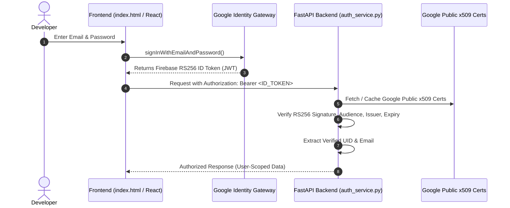

# Stroke V1 — Firebase Authentication & Identity Architecture

This document specifies the setup, cryptographic trust boundary, and configuration for Firebase Authentication across Stroke V1 (Desktop PyWebView, React/TanStack frontend, and FastAPI backend).

---

## 1. Overview & Identity Model

Stroke V1 permanently replaces custom OTPs, in-memory identity stores, and Supabase Auth with official **Firebase Authentication**.

### Core Guarantees
1. **Password Authority**: Firebase Authentication is the sole authority for password storage, hashing, and credential validation. Passwords, password hashes, and OTPs are **never** stored in Firestore, local files, caches, logs, browser storage, or analytics.
2. **Cryptographic Identity Verification**: Every protected request must carry a valid Firebase ID token in the `Authorization: Bearer <ID_TOKEN>` header.
3. **No Guest Bypasses**: Guest mode, offline bypasses, and unauthenticated workspace access are completely removed.
4. **No Client-Supplied Identity Trust**: The backend derives the caller's identity (`uid`, `email`) strictly from the verified ID token. Query parameters (`?email=...`) or JSON body fields can never override or spoof the authenticated user's identity.

---

## 2. Desktop / Trust Boundary Architecture

### The Problem With Packaging Admin Service Account Keys
In desktop client applications (such as PyWebView or Tauri binaries running on end-user machines), **bundling a Firebase Admin service-account private key (`service-account.json`) is a critical security vulnerability**. Any user or attacker inspecting the app package, memory, or local disk could extract the private key and gain administrative read/write access to the entire Firebase project, bypassing all Firestore Security Rules.

### The Stroke V1 Public Key Verification Solution
Stroke solves this securely without bundling private keys:



1. **Client-Side Auth**: The client uses the official Firebase Web SDK to sign in directly against Google's Authentication servers using standard API keys (which are project identifiers, not secrets).
2. **RS256 ID Tokens**: Google issues a short-lived (1 hour) JSON Web Token (JWT) signed by Google's private key.
3. **Public Cert Verification**: The backend verifies the token using Google's publicly hosted x509 certificates (`https://www.googleapis.com/robot/v1/metadata/x509/securetoken@system.gserviceaccount.com`) via `google.oauth2.id_token.verify_firebase_token`.
4. **Verification Checks Enforced**:
   - **Signature**: Validated against Google's public keys.
   - **Audience (`aud`)**: Must strictly equal `FIREBASE_PROJECT_ID` (`stroke-cyber-matrix`).
   - **Issuer (`iss`)**: Must strictly equal `https://securetoken.google.com/<FIREBASE_PROJECT_ID>`.
   - **Expiration (`exp`)**: Must be in the future (validated with clock skew tolerances).
   - **Subject (`sub`/`user_id`)**: Must be a non-empty string representing the user's UID.
5. **Admin SDK Scoping**: Any server-side operations that use the Admin SDK bypass client Firestore rules; therefore, the backend explicitly performs server-side ownership checks (`where uid == user.uid` or `document(user.email)`).

---

## 3. Firebase Console Configuration Guide

To configure a Firebase project for Stroke V1, follow these steps in the [Firebase Console](https://console.firebase.google.com/):

### Step 1: Enable Email/Password Sign-In Provider
1. Open your project in the Firebase Console.
2. Navigate to **Build > Authentication > Sign-in method**.
3. Under **Sign-in providers**, click **Email/Password**.
4. Enable **Email/Password**.
5. Enable **Email link (passwordless sign-in)** if desired, or keep password-based authentication active.
6. Click **Save**.

### Step 2: Configure Authorized Domains
1. In **Authentication > Settings > Authorized domains**, add the following domains:
   - `localhost`
   - `127.0.0.1`
   - Your production domain (if deploying web version)
2. Desktop apps running via loopback (`127.0.0.1:<PORT>`) will authenticate seamlessly against these authorized domains.

### Step 3: Configure Email Action Templates
1. Navigate to **Authentication > Templates**.
2. **Email address verification**: Customize the subject line and sender name (e.g. `Stroke AI // Autonomous Engineering`).
3. **Password reset**: Customize the message for developers resetting their passwords.

---

## 4. Environment Variables Specification

The application requires only public project identifiers for token verification and client initialization. **Never commit secret keys or private service-account files.**

| Environment Variable | Required | Default | Description |
|---|---|---|---|
| `FIREBASE_PROJECT_ID` | Optional | `stroke-cyber-matrix` | The authoritative Firebase project identifier. |
| `FIREBASE_AUTH_EMULATOR_HOST` | Optional | *None* | Set to `127.0.0.1:9099` when running the local Firebase Auth Emulator. |
| `VITE_FIREBASE_API_KEY` | Optional | Client Fallback Key | Web API key from Firebase Console (safe for client bundling). |
| `VITE_FIREBASE_AUTH_DOMAIN` | Optional | `<PROJECT_ID>.firebaseapp.com` | Auth domain for OAuth and redirects. |

---

## 5. Local Offline & Emulator Testing

Stroke fully supports offline local testing using the official Firebase Local Emulator Suite.

### Starting the Firebase Auth Emulator
```bash
# Install Firebase CLI if not already installed
npm install -g firebase-tools

# Start the Authentication Emulator on port 9099
firebase emulators:start --only auth
```

### Pointing Stroke to the Emulator
Set the environment variable before launching the backend and frontend:
```bash
export FIREBASE_AUTH_EMULATOR_HOST="127.0.0.1:9099"
export VITE_FIREBASE_AUTH_EMULATOR_HOST="127.0.0.1:9099"

# Start the supervisor
python3 desktop.py
```
When `FIREBASE_AUTH_EMULATOR_HOST` is detected:
- The backend automatically directs verification to `http://127.0.0.1:9099`.
- The frontend connects via `connectAuthEmulator(auth, "http://127.0.0.1:9099")`.
- 100% of authentication operations (register, login, verify, reset, delete) succeed locally without any internet connection.

---

## 6. API Endpoints Reference

| Method | Endpoint | Auth Required | Description |
|---|---|---|---|
| `GET` | `/auth/config` | No | Returns public client Firebase config (`projectId`, `authDomain`, `emulatorHost`). |
| `GET` | `/auth/me` | Yes (`Bearer <token>`) | Returns verified user identity (`uid`, `email`, `email_verified`, `display_name`). |
| `POST` | `/auth/session` | Yes (`Bearer <token>`) | Handshakes and validates active Firebase token with the backend. |
| `POST` | `/auth/logout` | Optional | Acknowledges client sign-out and clears server session state. |
| `DELETE` | `/auth/account` | Yes (`Bearer <token>`) | Purges backend user records (chats, memory, profile) upon account deletion. |
| `POST` | `/auth/send-otp` | N/A | **410 Gone**: Deprecated legacy endpoint; points clients to Firebase Auth. |
| `POST` | `/auth/verify-otp` | N/A | **410 Gone**: Deprecated legacy endpoint; points clients to Firebase Auth. |
| `POST` | `/auth/switch-account` | N/A | **410 Gone**: Deprecated legacy endpoint; points clients to Firebase Auth. |
